# GhostPermission

GhostPermission is an AI-agent payment authorization gateway built for the PayPal AI Hackathon. It receives a purchase intent, validates it against a server-owned real workspace catalogue and deterministic policies, requires human approval where needed, and only then permits a PayPal Sandbox order to be created.

> AI may interpret a request. It never authorizes a payment. The server policy engine is authoritative.

## Current implementation status

- Empty-by-default real workspace: no seeded identities, merchants, products, transactions, or metrics. Operators register their own approved merchants and products in Settings.
- Server-owned merchant allowlist, product catalogue, currency, prices, quantity caps, per-transaction and daily limits.
- Deterministic payment authorization, human approval workflow, replay protection, transaction persistence, incidents, and hash-chained audit logging.
- PayPal Orders API adapter for Sandbox OAuth, order creation, order verification, and capture verification.
- No real payment success is fabricated. Without Sandbox credentials, order creation returns a clear configuration error and no order ID is recorded.
- Local intent parser is available for the trusted catalogue. Live AI intent extraction intentionally fails safely until a configured provider adapter is enabled.

## Architecture

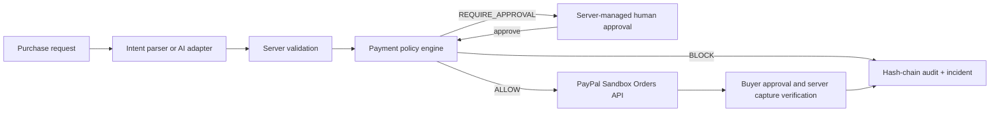

## Key capabilities

- **Sequence-aware authorization:** detects unsafe combinations of individually permitted agent actions.
- **Payment integrity:** ignores browser-supplied amount, currency, merchant, approval, and status fields.
- **Human approval gate:** requires a server-configured approval token for high-risk payment decisions.
- **Replay resistance:** request IDs make payment authorization retries idempotent.
- **Auditability:** every policy, payment, workflow, incident, and approval event is stored in a SHA-256 hash chain.
- **Honest integrations:** a missing PayPal configuration returns an explicit error; no mock payment success is shown.

## Screenshots

### Security Overview

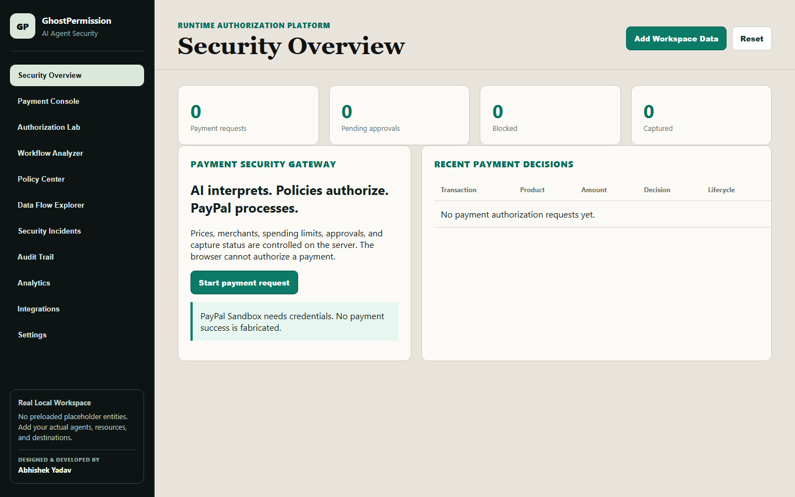

### Payment Console

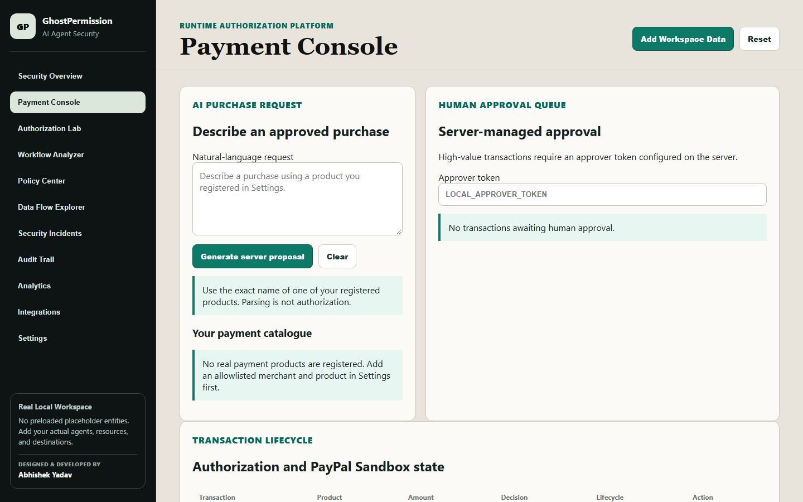

### Authorization Lab

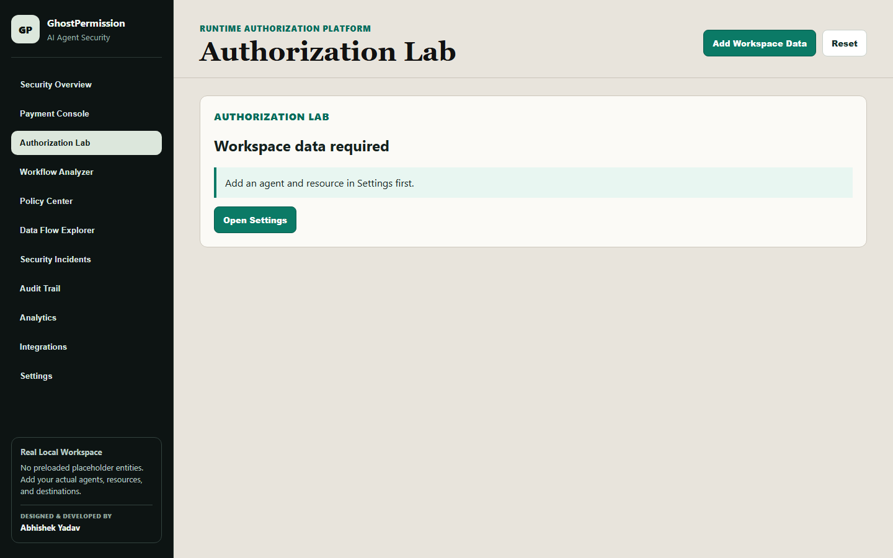

### Workflow Analyzer

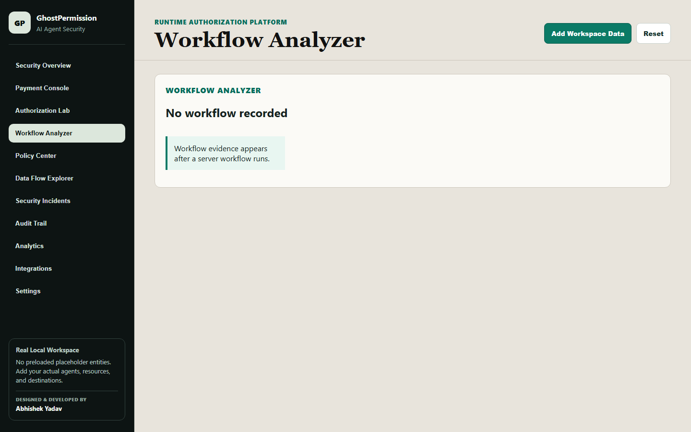

### Policy Center

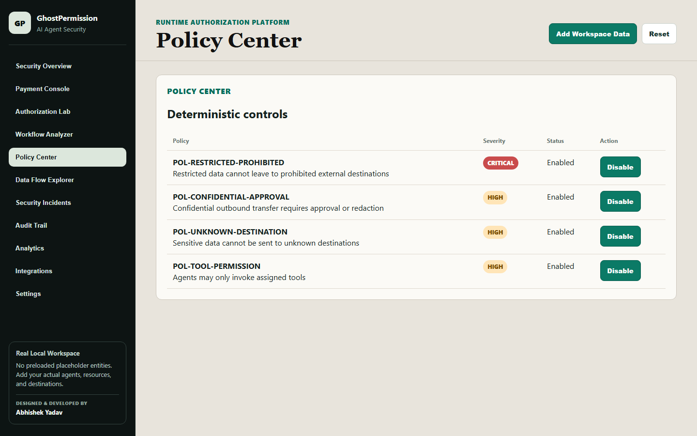

### Data Flow Explorer

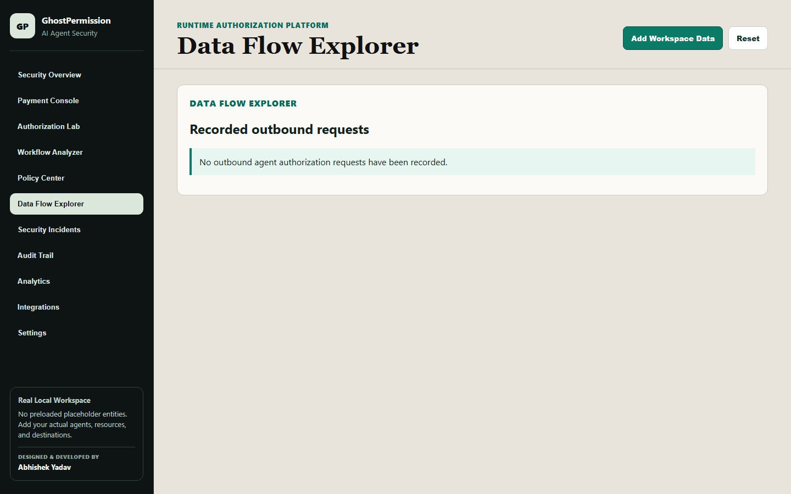

### Security Incidents

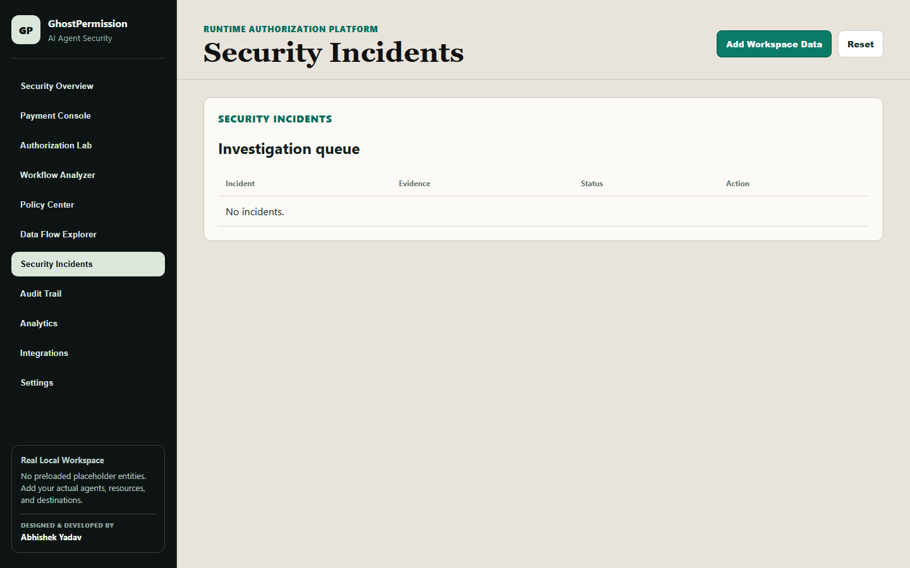

### Audit Trail

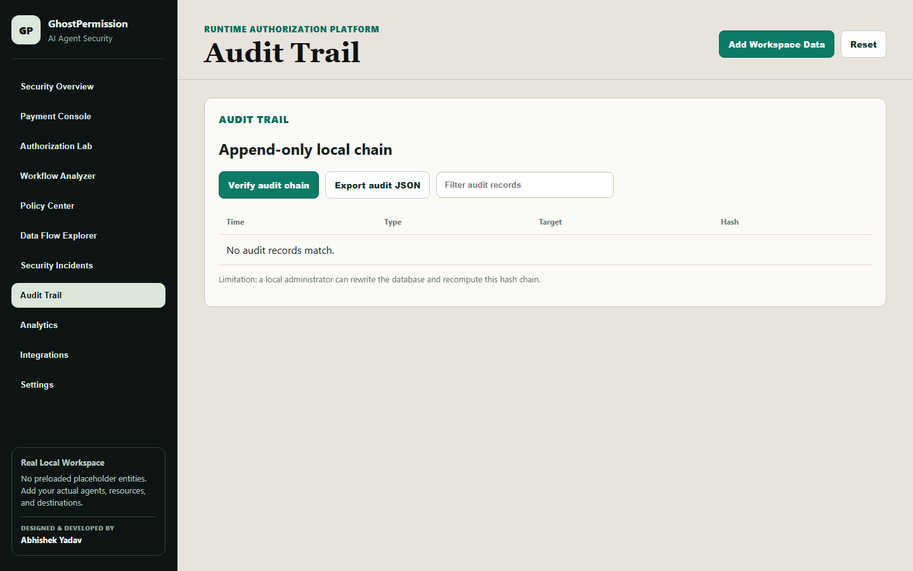

### Analytics

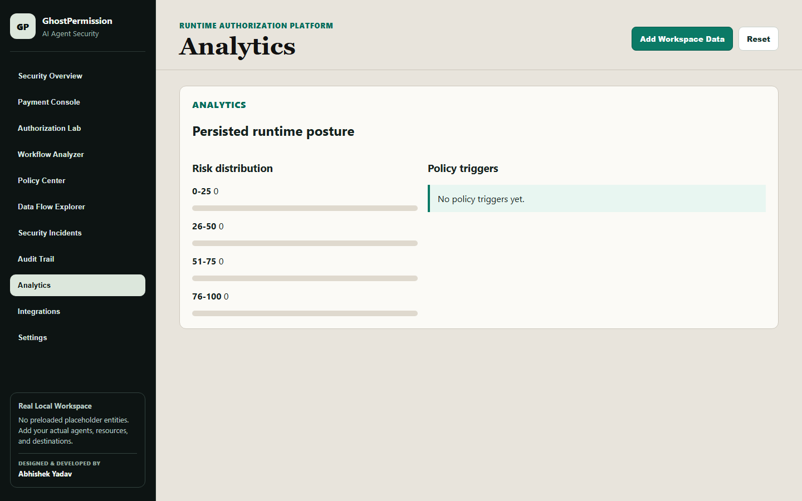

### Integrations

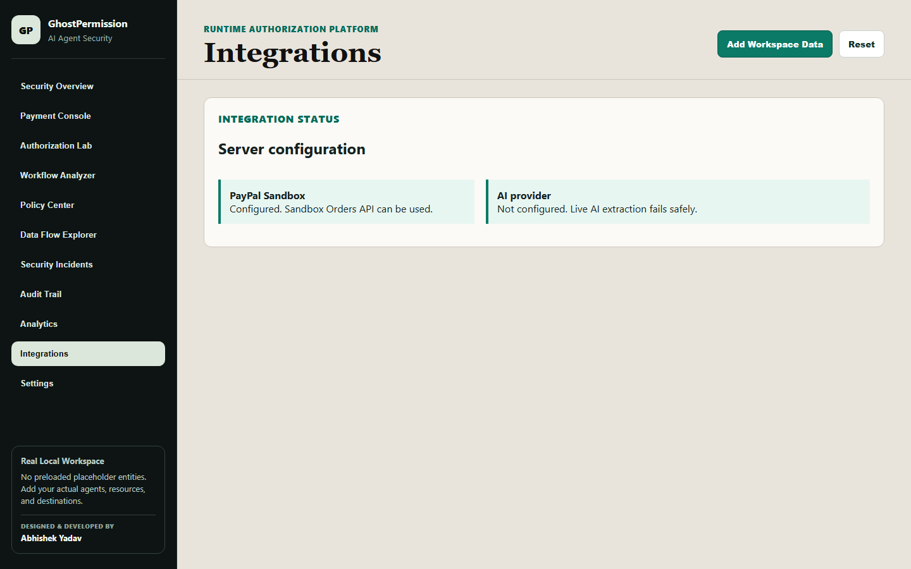

### Real Workspace Setup

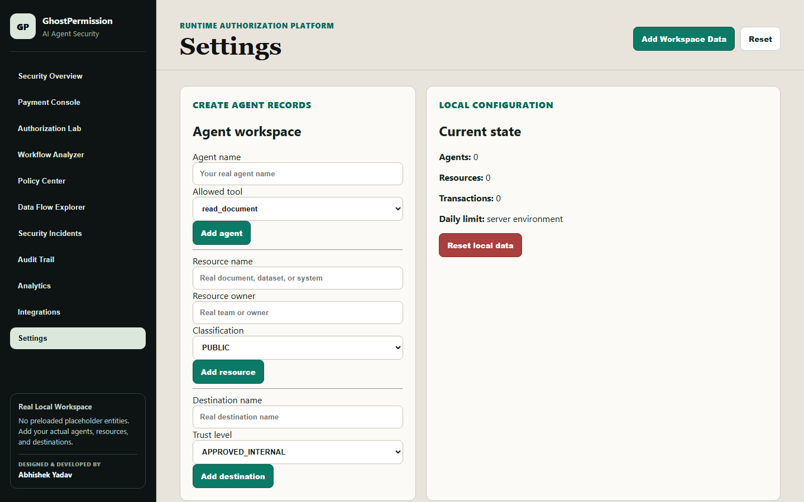

## Run locally

Requirements: Node.js 18 or newer.

```powershell
cd "C:\Users\654000\Desktop\CyberSecurityProjects\GhostPermission"
Copy-Item .env.example .env
npm start
```

Open `http://127.0.0.1:5173`.

## Environment

Copy `.env.example` to `.env`; `.env` is ignored by Git.

| Variable | Purpose |
| --- | --- |
| `PAYPAL_CLIENT_ID` | PayPal Sandbox REST application client ID |
| `PAYPAL_CLIENT_SECRET` | PayPal Sandbox REST application secret; server-only |
| `PAYPAL_BASE_URL` | `https://api-m.sandbox.paypal.com` |
| `AI_PROVIDER`, `AI_API_KEY`, `AI_MODEL` | Live AI provider configuration; never exposed to the browser |
| `DAILY_SPEND_LIMIT_CENTS` | Server-side daily spending limit, default `10000` |
| `PER_TRANSACTION_LIMIT_CENTS` | Server-side per-transaction limit, default `5000` |
| `REQUIRE_HUMAN_APPROVAL_FOR_HIGH_RISK` | Enables high-value approval gating |
| `LOCAL_APPROVER_TOKEN` | Required only for local approval API requests |
| `LOCAL_ADMIN_TOKEN` | Required to reset local data or change policy state |
| `ALLOWED_ORIGIN` | Browser origin allowed by the local API, default `http://127.0.0.1:5173` |

Do not commit `.env`, Sandbox credentials, access tokens, or approval tokens.

## PayPal Sandbox setup

1. Create a Sandbox REST application in the PayPal Developer Dashboard.
2. Add its client ID and secret to `.env`.
3. Use a Sandbox buyer account for checkout.
4. Submit a trusted catalogue request in Payment Console.
5. Only a transaction with status `AUTHORIZED` can create a PayPal order.
6. After buyer approval, the server rechecks PayPal order status and verifies currency/amount before recording `CAPTURED`.

No production PayPal endpoint or live money is used by this project.

## First-use workflow

1. Open **Settings** and register an allowlisted merchant you are authorized to use.
2. Register a product/service with its server-owned price, currency, and maximum quantity.
3. Create the real agent, resource, and destination records used by your local workspace.
4. Open **Payment Console**, submit a request using the exact registered product name, then authorize it.
5. For high-risk requests, approve or reject with `LOCAL_APPROVER_TOKEN`.
6. When PayPal Sandbox credentials are configured, create the PayPal order, complete buyer approval, and capture it through the server.

## API overview

| Endpoint | Description |
| --- | --- |
| `POST /api/purchases/intent` | Parses a local trusted-catalogue request or fails safely for unconfigured live AI |
| `POST /api/purchases/authorize` | Server-side trusted-catalogue and spending policy evaluation |
| `GET /api/transactions` | Persisted transaction states |
| `POST /api/transactions/:id/approval` | Human approval/rejection; requires `X-Approval-Token` |
| `POST /api/transactions/:id/paypal-order` | Creates a real PayPal Sandbox order only after `AUTHORIZED` |
| `POST /api/transactions/:id/capture` | Verifies approved order and capture response server-side |
| `GET /api/audit/verify` | Verifies hash-chain integrity |

## Security design

- Client-provided amount, merchant, currency, status, and `approved` flags are ignored.
- Only catalogue product IDs determine price, merchant, currency, and quantity rules.
- Payment request IDs prevent duplicate transaction persistence.
- PayPal order/capture endpoints only run after server authorization.
- High-value payments enter `AWAITING_APPROVAL`; a browser boolean cannot bypass it.
- Prompt-injection language is rejected at the intent boundary and cannot change policies.
- Audit records are created on the server and chained with SHA-256 hashes.

### Audit limitation

The local hash chain detects modified records inside the stored chain. It is not immutable storage: a local administrator with filesystem access could rewrite the database and recompute hashes. Production deployment should use an external immutable log or attestation service.

## Tests

```powershell
npm run lint
npm test
npm run verify
```

The test suite covers authorization decisions, sequence blocking, disabled policies, audit tamper detection, trusted catalogue validation, prompt injection rejection, forged approval resistance, approval lifecycle, duplicate/replay handling, and safe missing-PayPal-configuration behavior.

## Demonstration scenario

Use a product that you registered in Settings. The request must include its exact product name. To demonstrate a blocked path, submit a request containing an attempt to bypass policy controls; the intent boundary rejects it before a PayPal order can be created. For an approval path, configure a lower `PER_TRANSACTION_LIMIT_CENTS` and submit a registered product request that exceeds the high-risk threshold.

## Known limitations

- Live PayPal checkout/capture requires valid Sandbox credentials and a Sandbox buyer account.
- The current build has a local deterministic parser. A live AI adapter must be configured separately; it intentionally does not fake an AI result.
- This is a local single-user development application, not a production authentication system.

## Three-minute demo outline

1. Show the trusted catalogue and configured security limits.
2. Submit a trusted request and show server authorization.
3. Submit a prompt-injection or unknown-product request and show it blocked before PayPal.
4. Show a high-value request enter approval queue, then approve through the protected endpoint.
5. With Sandbox configured, create and capture the Sandbox order; otherwise show the explicit configuration-required state.
6. Verify the audit chain and inspect the transaction timeline.

## Author

Designed and developed by **Abhishek Yadav**.

## License

This project is released under the [MIT License](LICENSE).
